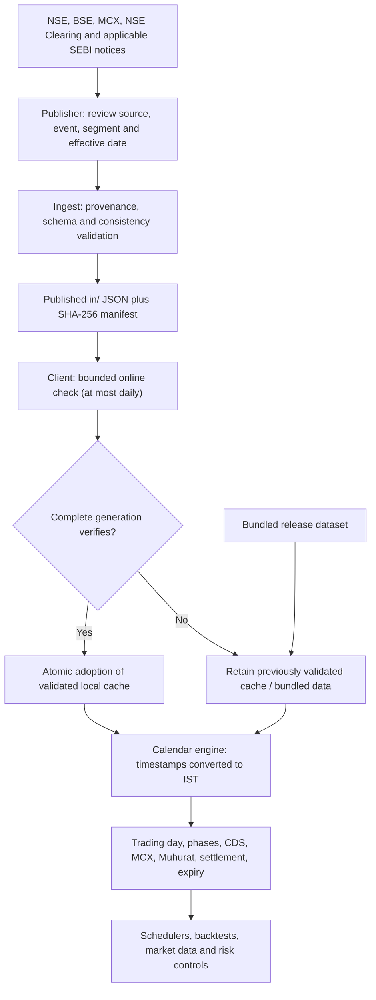
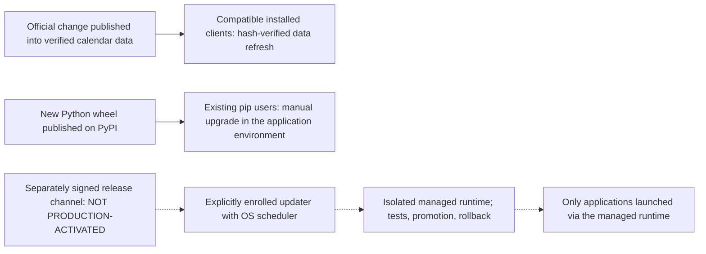

# AION Indian Market Calendar

MIT-licensed Python software for scheduled trading days, supported settlement
holidays, intraday phases and selected derivative expiries in India. No API key
is required. This is not a live exchange-status feed, broker interface, order
execution service or compliance guarantee. Exchange notices remain authoritative.

## Latest release: 1.8.0 (15 November 2026)

**Upgrade advisory for users of 1.7.1.** The published 1.8.0 wheel and source
distribution correct reproducible calendar-answer defects in 1.7.1. In the
Python environment that actually runs your application, use:

```bash
python -m pip install --upgrade aion-indian-market-calendar
python -c "import importlib.metadata as m; print(m.version('aion-indian-market-calendar'))"
```

Re-run your own schedule-critical checks and review the
[nine-case correction advisory](docs/CORRECTNESS_ADVISORY_1_8_0.md).
The [1.8.0 GitHub release](https://github.com/AION-Analytics-India/aion-indian-market-calendar/releases/tag/v1.8.0)
and [PyPI 1.8.0](https://pypi.org/project/aion-indian-market-calendar/1.8.0/)
give the publication and exact artifacts.

| 1.8.0 change | Why it matters |
| --- | --- |
| Unsupported dates and incomplete calendar coverage fail closed | An unknown future trading date is not silently treated as open |
| Timezone-aware timestamps are normalized to IST before selecting the calendar date | Cross-timezone calls no longer silently choose the wrong Indian trading day |
| Continuous trading, closing auction and confirmed NSE Muhurat windows are distinguished | A session being active does not imply normal continuous order matching |
| Verified data refresh is visible to already-loaded calendar readers | Accepted exchange updates do not require a new Python wheel |
| NSE CDS INR-pair hours and holidays remain distinct from NSE equity | `USDINR`, `EURINR`, `GBPINR` and `JPYINR`: **09:00-17:00 IST** on applicable sessions |

**How users hear about releases:** GitHub release subscribers and consumers of the
[PyPI releases RSS feed](https://pypi.org/rss/project/aion-indian-market-calendar/releases.xml)
can follow announcements. PyPI/pip cannot push a message to every previous
installer. A 1.7.1 install cannot acquire the new software-update checker
retroactively. Normal `pip install` does not activate unattended code updates.
Version 1.8.0 provides tested but **not production-activated** opt-in updater
components; they are not a promise of automatic upgrades on ordinary pip
environments.

## Install or manually upgrade

```bash
python -m pip install --upgrade aion-indian-market-calendar
```

**Version 1.8.0 was published on 15 November 2026.** See
[PyPI's release files](https://pypi.org/project/aion-indian-market-calendar/1.8.0/)
and the [GitHub release record](https://github.com/AION-Analytics-India/aion-indian-market-calendar/releases/tag/v1.8.0)
for the published artifact identities.
Use the Python interpreter that runs your application; restart/retest that
application under your own deployment procedure after upgrading.

[Canonical source](https://github.com/AION-Analytics-India/aion-indian-market-calendar),
[release history](CHANGELOG.md), [correction advisory](docs/CORRECTNESS_ADVISORY_1_8_0.md),
[product page](https://aionanalytics.in/open-source/indian-market-calendar),
[shared data](https://github.com/AION-Analytics-India/aion-market-calendar-data),
[LLM discovery index](llms.txt), [upgrade-notification tracking](https://github.com/AION-Analytics-India/aion-indian-market-calendar/issues/7)
and [issues](https://github.com/AION-Analytics-India/aion-indian-market-calendar/issues).
No AION API key is required. MIT licensed.

## Important correction for earlier versions - 14 November 2026

Independent checks reproduced correctness defects in the published **1.7.1**
wheel: some uncovered dates returned assumed trading answers, aware date helpers
could select the wrong IST date, and some continuous-session/Muhurat and
loaded-data-refresh answers were incorrect. We apologize for these errors and
the uncertainty they can cause developers.

For example, the 1.7.1 class helper returned `True` for an unsupported
`2027-01-26T10:00:00+05:30` market-open query. Version 1.8.0 raises `ValueError`
for that unknown date. It does **not** add 2027 calendar coverage. The
[dated advisory and nine-case before/after matrix](docs/CORRECTNESS_ADVISORY_1_8_0.md)
identify the tested affected version, exact inputs, verified corrections and
limits. Earlier versions have not been independently established as affected by
these same nine cases. No live trade or loss is inferred from the package tests.

A current holiday cache does not repair Python-code defects. Existing users
must manually upgrade the environment used by their application, confirm the
installed version and retest schedule-critical behavior against exchange notices.
Yanking a release does not uninstall it; exact pins/lockfiles may still select it.

```bash
python -c "import importlib.metadata as m; print(m.version('aion-indian-market-calendar'))"
```

## Platforms and release scope

| Capability | macOS | Linux | Windows |
| --- | --- | --- | --- |
| Calendar library, Python 3.10-3.14 | Native wheel/sdist checks | Native wheel/sdist checks | Windows Server 2022 x64; plus Windows 11 ARM64 with x64 Python 3.11.9 (wheel and sdist) |
| Optional managed-updater lifecycle | launchd tested in isolation | User systemd tested in isolation | Task Scheduler 17/17 on Server 2022 x64 and Windows 11 ARM64/x64 Python; rollout paused |
| Production automatic code installation | Not activated | Not activated | Paused; not activated |

One universal wheel serves these tested library platforms. Python 3.9 is
unsupported. Linux managed setup requires working `venv`/`ensurepip`; it refuses
an installation missing those facilities. Native Windows 11 x64 desktop, Windows 10 x64 desktop, ordinary-user
consumer acceptance and real reboot/logon persistence remain unverified.
The Windows 11 runner used ARM64 hardware and an x64 Python interpreter; that is
not native x64 desktop acceptance. These optional-updater gates do not negate
the separately tested calendar library corrections.
See [build-time evidence and scope](RELEASE_STATUS.md).

## Covered dates and markets

Version 1.8.0 bundles Indian dataset 2026.11.14, with declared coverage
**2026-01-01 through 2026-12-25**. No Indian 2027 holiday payload is available
in this version. Unsupported session/date questions raise, including
next-trading-day searches that exhaust coverage. A calculated seasonal time
extending into another year is not holiday coverage for that year.

| Market scope | Scheduled behavior and limits |
| --- | --- |
| NSE/BSE cash | Choose generic cash or the separate F&O-underlying cash subset for CAS. This is not a symbol-membership master. |
| NSE/BSE equity derivatives | Segment schedules, not a determination of the trading cutoff for a particular expiring contract. |
| NSE CDS | USDINR, EURINR, GBPINR and JPYINR, 09:00-17:00 IST, with separate currency holidays. No BSE CDS or cross-currency contracts. |
| Non-agri commodity schedules | MCX/NSE seasonal close at 23:30 during US daylight saving and 23:55 otherwise, subject to sourced overrides. Agricultural contract hours are not modeled. |
| Settlement | NSE Clearing-style date utility, distinct from trading. Not a universal BSE/MCX/banking settlement service. |
| Expiries | NIFTY weekly Tuesday; listed NSE monthly indices last Tuesday; SENSEX Thursday. Covered holidays shift to the preceding trading day. No currency expiry or arbitrary contract master. |
| Muhurat | Separate NSE non-CAS cash, CAS cash and F&O windows from CMTR/76941 and FAOP/76940. BSE/MCX timings retain their existing provisional label. Unknown NSE F&O special schedules refuse. |

CDS aliases include `CDS`, `CURRENCY_DERIVATIVES`,
`NSE_CURRENCY_DERIVATIVES` and the four INR symbols above. A trading day can be
a settlement holiday: equity trades on 1 April 2026 while CDS and settlement
are closed.

### Currency derivatives (CDS) have a different session

| Supported NSE INR pair | Regular session (IST) | Calendar |
| --- | --- | --- |
| USDINR, EURINR, GBPINR, JPYINR | 09:00-17:00 | Separate currency-specific holidays |

This is not the equity session: regular equity pre-open is 09:00-09:15,
followed by continuous matching at 09:15-15:30, subject to dated special-session
and closing-auction rules. Currency trading and settlement days are distinct.
For example, CDS is closed on 1 April 2026 while NSE equity trades; settlement
is also closed. BSE CDS, cross-currency contracts, currency expiry calculation
and individual contract cutoffs are outside the supported contract.
[NSE market timings](https://www.nseindia.com/resources/exchange-communication-market-timings)
and the versioned bundle supply scope and provenance; exchange notices prevail.

## Effective 7 December 2026

[SEBI circular HO/47/11/11(3)2025-MRD-POD2/I/23843/2026, 15 October 2026](https://www.sebi.gov.in/sebi_data/attachdocs/oct-2026/1792079571420.pdf)
is represented by an effective-dated rule in version 1.8.0:

- F&O-underlying cash continuous matching ends at 15:30 IST; CAS is 15:30-15:40.
- The general equity-derivatives segment continues until 15:45.
- Expiring index contracts stop at 15:30 on their expiry day. The generic
  segment query cannot identify an individual contract's expiry cutoff.
- Cash post-close is 15:50-16:00.

Earlier dates retain the applicable earlier schedule. CAS output describes a
scheduled envelope; it cannot observe system-driven random order-entry closure
or actual auction completion. The February 2027 order-transition provision is
not a new holiday calendar or a supported 2027 session claim.

## Offline examples

Set the offline policy before importing or using the package:

```python
import os
os.environ["AION_IN_CALENDAR_OFFLINE"] = "1"

from datetime import date
from aion_indian_market_calendar import (
    IndiaMarketCalendar, get_market_phase, get_expiry_day,
    is_trading_day, is_settlement_day,
)

cal = IndiaMarketCalendar.bundled(2026)
assert cal.covers(date(2026, 11, 13))
assert cal.is_market_open("2026-11-13T16:30:00+05:30", market="CDS")
assert not cal.is_continuous_trading("2026-11-13T09:05:00+05:30", market="NSE")
assert get_market_phase("2026-12-07T15:30:00+05:30",
                        "NSE_EQUITY_FNO_UNDERLYING", calendar=cal) == "CLOSING_AUCTION"
assert is_trading_day("2026-04-01", calendar=cal)
assert not is_settlement_day("2026-04-01", calendar=cal)
assert str(get_expiry_day("NIFTY", "2026-10-19", calendar=cal)) == "2026-10-19"
```

Class methods are datetime-first (`cal.is_market_open(at, market=...)`).
Module convenience functions are market-first (`is_market_open("CDS", at=...)`).
Aware date-taking and timestamp-taking helpers convert to IST before choosing
the calendar date. Naive clocks retain the compatibility assumption of IST,
with a warning. A plain date has no clock and does not warn.

`get_market_phase` returns `PRE_OPEN`, `CONTINUOUS`, `CLOSING_AUCTION`,
`POST_CLOSE`, `MUHURAT_TRADING` or `CLOSED`. Its windows and continuous-matching
checks are half-open. The legacy `is_market_open` activity envelope retains its
inclusive close edge for compatibility; it is not an ordinary-order gate.
Use the phase or continuous-matching helper to distinguish matching from other
operations. No function observes real-time halts.

`from_json` accepts a caller-owned explicit calendar. `from_records` and legacy
custom files without a range establish only dates with supplied holiday or
session facts; intervening weekdays and empty calendars remain unknown.
The caller remains responsible for completeness of custom records.
`holidays(year=...)` is a list for the covered portion, not a claim of a full
calendar year. `covers()` reports the precise interval.

## Architecture: official announcements to calendar answers

This is an **exchange-announcement-driven calendar**, not a static list of
weekdays. Exchange circulars and official calendars are the authority; AION's
[shared data repository](https://github.com/AION-Analytics-India/aion-market-calendar-data)
is the controlled publication surface for checked event and session records.
The source repository contains an `ingest` verification/publishing tool; it does
not by itself establish a guaranteed daily official-source monitoring SLA.
**Clients** check for an updated published dataset at most once per day.
Changes in official market rules require source adjudication before publication.



The manifest binds downloaded files by SHA-256 and validates the dataset
structure. **The calendar-data manifest is hash-verified, not digitally
signed.** Offline mode prohibits refresh and uses a verified cached/bundled
generation. If the date or special-session information is unavailable, the
calendar refuses unsupported answers rather than inventing a trading schedule.
Official exchange circulars supersede the library.

### Two different update paths



**Software patches are not calendar-data refreshes.** A PyPI upload alone
does not replace installed code, install a background task or relaunch trading
applications. The signed, opted-in patch updater has passed disposable
lifecycle tests but production signing, trusted bootstrap/channel and remaining
Windows desktop gates are open. See
[update contract](docs/UPDATE_CONTRACT.md) and
[release scope](RELEASE_STATUS.md).

## Benefits, use cases and scope

- **Indian exchange session validation:** NSE, BSE, MCX and supported NSE CDS
  INR pairs, with market-specific holidays and effective-dated timing rules.
- **Trading is not settlement:** NSE Clearing settlement dates and CDS holidays
  cannot be inferred from cash-equity trading status.
- **Intraday-aware scheduling:** Separate pre-open, continuous trading,
  closing auction, post-close and confirmed special sessions.
- **Reproducible research:** Exchange-specific historical checks with explicit
  timezone conversion and known coverage; useful for backtests, event
  intelligence, data pipelines, Python fintech applications and algo-trading
  risk gates.
- **Offline operation:** A bundled verified dataset works without a hosted API,
  user account or subscription; compatible verified datasets can refresh without
  a package rebuild when network use is permitted.

**Not included:** live exchange halt detection, broker connectivity, order
execution, symbol-to-segment or contract master, individual derivatives-contract
cutoff verification, BSE CDS, cross-currency contracts, per-contract MCX
agricultural hours, guaranteed coverage beyond verified official sources or
automatic upgrades of arbitrary Python environments.

**Developer discovery:** Indian market calendar Python; NSE market timings;
NSE trading holidays; BSE market calendar; MCX commodity session calendar;
NSE currency derivatives CDS 09:00-17:00 IST; USDINR market hours; NIFTY
expiry calendar; Indian market settlement calendar; Muhurat trading session;
closing auction session CAS; Indian stock market holiday API; Python trading
session validator; DST-aware MCX market hours; offline market calendar.

## Calendar data refresh and Python software updates

**Calendar data:** ordinary online loads may check compatible approved public
data, with a daily check throttle and a bounded synchronization check in loaded
readers. Set `AION_IN_CALENDAR_OFFLINE=1` to prohibit package network refresh,
including explicit refresh and RSS polling. Offline uses verified cache or
bundle. A failed check keeps validated data, not fabricated future answers.

`python -m aion_indian_market_calendar update --force` explicitly checks data.
Exit 0 means current/updated, 1 means failed, 2 means offline/not attempted.
`AION_IN_CALENDAR_URL` selects the data origin; `refresh_url` remains an ignored
legacy argument. Manifest schema, metadata, payload structure and SHA-256 must
verify before an atomic generation switch. HTTPS transfer is required except
explicit loopback fixture origins. These manifests are not digitally signed.
`store.status()` reports coverage, generation, freshness, review due and the
last refresh. A review reminder is separate from the supported-date boundary.

**Python software:** no import, normal API call or data refresh runs pip.
Version discovery is an explicit authorized operation against an approval
manifest whose SHA-256 the deployment owner provides independently. A separate
opt-in supervisor verifies the complete wheel closure, creates an isolated
candidate environment, installs without an index, runs compatibility checks,
and atomically promotes an environment pointer. It retains the previous
accepted environment for explicit rollback. It does not restart an application.

External PyPI users need their own authorized package automation. The managed
lifecycle is experimental and not currently production-activated. AION-protected deployments require
their independently approved controller and cannot use customer-mode admission. **Existing 1.7.1 installations cannot retroactively gain it.**
See [the complete update contract](docs/UPDATE_CONTRACT.md).

## Safety, history and license

No persistent installation identifier, telemetry service, model code or private
data is included. The retired non-calendar update entry point performs no
updates. The historical [telemetry audit](docs/TELEMETRY_AUDIT.md) and all prior
[release notes](CHANGELOG.md) are retained; newer behavior does not repair old
installations automatically. Code and documentation are MIT licensed.

## Optional managed software updates: experimental, not production-activated

**Ordinary pip installation or upgrade does not register a background task,
enroll a managed environment, switch an application interpreter or silently
install future Python patches.** Calendar-data refresh is a separate mechanism.

The optional updater was exercised with disposable signed channels on macOS,
Linux and Windows. Its production signing identity, approved release channel,
bootstrap distribution and protected-workload acceptance remain blocked.
Windows updater rollout is paused. Do not treat the engineering setup interface
as a ready customer one-command enrollment service.

A future approved setup will require explicit consent, a trusted policy and
approved bootstrap artifacts. Notification-only consent is distinct from
unattended-install consent. It manages a separately adopted runtime and leaves
the original pip environment unchanged; only applications explicitly launched
through that runtime use its accepted version. Pins, supported patch series,
signature/health checks, offline policy and active-workload admission can defer
or reject an update. The pinned updater controller needs a separately reviewed
bootstrap; runtime patches do not automatically replace it.

Availability notices are local receipts/output, not email, desktop toasts or
push messages. No universal all-future-patch upgrade promise is made. Full
engineering controls, disable/uninstall/rollback and ownership boundaries are in
[UPDATE_CONTRACT.md](docs/UPDATE_CONTRACT.md). No production signing credential
or default production channel is included in this package.

## Verify and report a defect

The source distribution includes the complete tests and immutable historical
fixtures. The CI workflow installs wheel and sdist separately and verifies their
code/data/license/README identity and installed import paths. Its independent
42-case probe is `scripts/verify_independent_contract.py`; the artifact verifier
supplies its fixture paths and isolated cache. Reproduce using the exact source
and artifacts recorded in the release evidence, never an editable fallback.

Report the package version, Python/OS, exchange/segment, timezone-aware timestamp,
actual/expected result, public circular and minimal reproducer through
[GitHub issues](https://github.com/AION-Analytics-India/aion-indian-market-calendar/issues).
Do not include credentials, account records or proprietary trading inputs.

### Proposed notification support (not part of published 1.8.0)

The review implementation adds optional desktop notifications at consent-based setup and a headless notice/acknowledge command. A verified signed release is required before offering an upgrade. Native desktop display, production key custody, trusted bootstrap and rollout require separate acceptance. Existing pip environments are not automatically enrolled.
