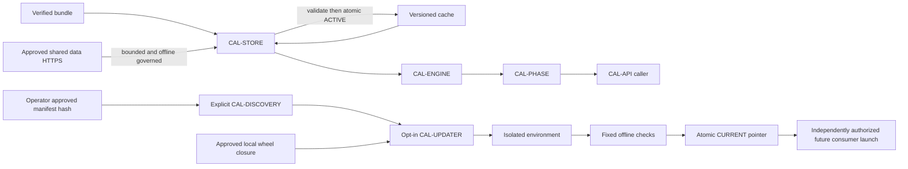
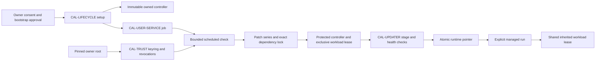
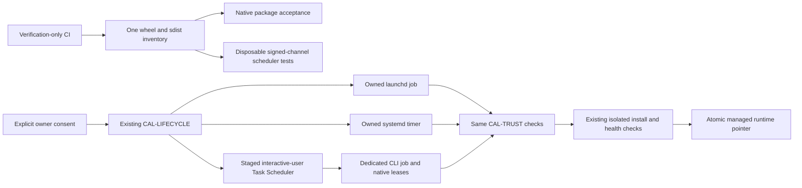
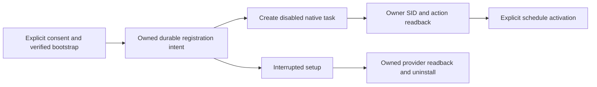

# Indian Market Calendar - source and update map

Updated 14 November 2026 for the isolated 1.8.0 candidate. Published PyPI remains
1.7.1 until a separately approved release. Paths are repository-relative.

## Components and boundaries

| ID | Path | Responsibility and dependency |
| --- | --- | --- |
| CAL-API | src/aion_indian_market_calendar/__init__.py | Public helpers and version, delegates to calendar/microstructure. No software upgrade on import or query. |
| CAL-ENGINE | src/aion_indian_market_calendar/calendar.py | Covered session queries, aliases, IST conversion, effective rules, explicit event overrides. Reads CAL-DATA. |
| CAL-PHASE | src/aion_indian_market_calendar/microstructure.py | Half-open phases, settlement and supported expiries, uses CAL-ENGINE. |
| CAL-MODELS | src/aion_indian_market_calendar/models.py | Event/session dataclasses, no network. |
| CAL-STORE | src/aion_indian_market_calendar/store.py | Validates manifest/payloads, bounded HTTPS refresh, serialized atomic generation adoption and reader sync. Uses fetch_bytes from CAL-DISCOVERY for transfer only. |
| CAL-DATA | src/aion_indian_market_calendar/data/ | Offline candidate dataset 2026.11.14, 2026-01-01 through 2026-12-25; manifest generated by shared-data owner. No 2027 payload. |
| CAL-DISCOVERY | src/aion_indian_market_calendar/software_updates.py | Explicit approved stable-version discovery and bounded transport. Operator supplies independent approval hash. Never installs. |
| CAL-UPDATER | src/aion_indian_market_calendar/managed_updater.py | Separate opt-in supervisor, local approved wheel closure -> isolated venv -> smoke/pip check -> CURRENT.json promotion or rollback. Never invoked by normal API. |
| CAL-CLI | src/aion_indian_market_calendar/__main__.py | Explicit data update and bounded RSS review polling, both honor offline. Does not admit data or upgrade software automatically. |
| CAL-LEGACY | src/aion_indian_market_calendar/live_overrides.py, live_events.json | Retained compatibility/history helpers, not the verified-store adoption path. Retired taxonomy activation never fetches or updates another product. |
| CAL-TESTS | tests/ | Original suite, lifecycle and concurrency tests; release repairs and updater contract tests. Fixture snapshots dataset_2026_10_18 and dataset_2026_11_03 are immutable historical inputs. |
| CAL-PACKAGE | pyproject.toml, MANIFEST.in | MIT, Python >=3.10, pytz/tzdata; tested PEP639 floor setuptools >=77.0.3. Complete tests/fixtures in sdist. |
| CAL-RELEASE | .github/workflows/publish.yml, scripts/ | Tag-triggered tests/build/publication; no trigger invoked by this work. |
| CAL-DOCS | README.md, docs/UPDATE_CONTRACT.md, docs/tutorials/, examples/ | Candidate behavior and update contract, source examples. CHANGELOG.md and docs/TELEMETRY_AUDIT.md preserve history. |
| CAL-RECORDS | DEVELOPMENT_JOURNAL.md, JOURNAL_AGENT_MISTAKES.md, NEVER_DO_AGAIN.md, SITEMAP_CHANGE_JOURNAL.md | Distinct engineering, actual mistakes, prevention and architecture histories. |

## Data flow

## External dependencies and persistent state

Only public calendar-data from AION-Analytics-India/aion-market-calendar-data
is consumed automatically when online. Exchange/regulator URLs in data are
provenance, not inference services. Software approval/artifact sources are
explicit operator-controlled boundaries; discovery is not a background PyPI
query. Runtime dependencies: pytz, tzdata. Supervisor uses stdlib venv,
ensurepip and local pip; no model, broker, trading, database or billing imports.
Optional RSS parsing uses feedparser after a bounded explicit fetch.

Data cache: ACTIVE, datasets/, .adoption.lock, .last_check, .last_refresh.json
and compatibility flat copies. Upgrade root: UPDATE.lock, CURRENT.json,
environments/*/ACCEPTED.json, approved-wheels/ and upgrades.jsonl. The low-level updater installs no scheduler or consumer restart. Explicit
customer supervision is mapped separately under CAL-LIFECYCLE. Data and software generations are
independent. File locks are temporary and excluded from distribution.

## Proof and unresolved boundaries

See the test modules for source-level proofs and the independently retained
release acceptance receipts. The December 7 revision is an effective-dated
scheduled envelope, not live auction telemetry. Per-contract expiry cutoffs,
Indian 2027 coverage, BSE CDS/cross-currency and agricultural contract-specific
sessions remain unsupported. BSE/MCX Muhurat metadata remains provisional.
Shared /in publication needs a separate legacy-client compatibility gate; old
clients cannot be assumed to enforce minimum-client declarations.

Final candidate reconciliation: the Muhurat convenience API also refuses an
unknown NSE F&O special schedule; unrelated unsupported overrides are ignored
when resolving a known market. Retired compatibility validation resolves only
calendar-owned cache space. These are source/API boundaries, not production
changes. Regression cases live in tests/test_release_repairs.py.

### CAL-AUTO - opted-in software supervisor

src/aion_indian_market_calendar/automatic_updates.py adds explicit check/watch
operations: a pinned Ed25519 authority -> signed channel -> bounded allowlisted
artifact fetch -> CAL-UPDATER -> accepted environment pointer. Optional
`updates` dependency is cryptography >=45,<47; normal calendar APIs retain
pytz/tzdata only. CHANNEL.json stores sequence/digest, not credentials. Default
mode emits notices; installation requires a separate flag. This low-level command installs no service or
scheduler. tests/test_automatic_updates.py and
scripts/verify_automatic_update.py exercise real signature checks, replay,
offline refusal and the complete isolated automatic cycle. Production signing
and channel/policy distribution require separate owner activation.

### 2026-11-14 final auto-update claim verification

Documentation clarification only. CAL-AUTO is a foreground polling worker, not
an installed OS scheduler. Standard pip installs its modules without enabling
checks or adding signature dependencies. Managed adoption and external
controller/signing policy are additional prerequisites. Promotion changes an
isolated environment pointer, not the original pip environment. No runtime
architecture change: existing graph and implementation paths remain valid.

## CAL-LIFECYCLE - explicit user-managed update ownership (unreleased)

| ID | Path | Verified boundary |
| --- | --- | --- |
| CAL-LIFECYCLE | src/aion_indian_market_calendar/update_lifecycle.py | Explicit consent/setup -> immutable controller + owned runtime -> actual OS registration. Original pip environment remains unchanged. run holds an inherited workload lease; managed promotion defers while in use. Exact dependency pins/consumer constraints and protected-controller admission are enforced. |
| CAL-TRUST | src/aion_indian_market_calendar/update_trust.py | Independently provisioned root -> expiring monotonic release keyring/revocations -> signed patch-series/Python-compatible release. No production trust identity/channel is bundled. |
| CAL-USER-SERVICE | src/aion_indian_market_calendar/update_supervision.py | Only owned per-user launchd job or systemd service/timer. Start/stop/status/disable/uninstall read actual provider state. Login/user-manager restart scope; no sudo, lingering change or unrelated restart. Windows adapter staged; native acceptance pending. |
| CAL-LIFECYCLE-TESTS | tests/test_update_lifecycle.py, scripts/verify_managed_lifecycle.py | Trust/constraints/admission/failure isolation; real disposable OS scheduling and managed application execution, interruption/recovery and teardown. Test keys do not establish production trust. |

Protocol-2 update guards are kernel advisory locks inherited by installer
children; markers are recoverable only after holders exit. Unknown legacy
markers remain owner-reviewed. A local uninstall flag never replaces OS
readback. The original CAL-AUTO low-level foreground watcher remains available
but is not the customer service installer. No calendar data, API contract,
coverage, market rule, production endpoint, trading service or public platform
changes. Production trust activation remains a separate release gate.

CAL-RELEASE also includes scripts/sign_software_channel.py and
 tests/test_channel_signer.py: an explicitly approved offline signing controller
supplies a private-key descriptor; the tool validates and writes only public
signed metadata and never publishes. Production signing custody, channels and
approval remain external owner gates. Runtime wheel code remains the tested
2833fd0 generation. Disposable native launchd/systemd tests passed 15 cases on
each platform; source/installed artifact suites passed 274 cases before the
additional offline-signer CLI tests. No production activation is inferred.

## 2026-11-14 - current three-platform verification boundary

Current gate authority: RELEASE_STATUS.md. Earlier dated pass counts remain
historical; they do not attest Windows, real reboot or production trust.

| Component | Source | Boundary and proof |
| --- | --- | --- |
| CAL-WINDOWS-ADAPTER | windows_runtime.py, windows_supervision.py under src/aion_indian_market_calendar | Native WinAPI shared/exclusive leases, inherited handles, reparse/DACL checks, dedicated CLI Job Object and owned interactive Task Scheduler task. Staged; portable serialization verified, native acceptance pending. |
| CAL-CI-ARTIFACTS | .github/workflows/verify-candidate.yml, scripts/verify_release_artifacts.py | Read-only GitHub permissions, build once, exact wheel/sdist hash inventory, native 3-OS/5-Python package tests. No publishing or trust provisioning. |
| CAL-INDEPENDENT-PROBE | scripts/verify_independent_contract.py | Preserved independent 42-case probe; historical fixtures packaged in sdist, actual installed imports required. |
| CAL-OS-LIFECYCLE | scripts/verify_managed_lifecycle.py | Actual launchd/systemd/Task Scheduler checks, signed synthetic patch, interruption/recovery/rollback/teardown. Refuses unavailable user-manager or interactive session. |
| CAL-WINDOWS-TLS-FIXTURE | scripts/windows_fixture_tls.py | Loopback test TLS via in-memory OpenSSL; Windows-only test dependency pyOpenSSL, not a runtime updater dependency. No private key file or certificate-store registration. Supersedes the rejected SslStream fixture. |
| CAL-RELEASE-STATUS | RELEASE_STATUS.md, RELEASE_NOTES_1_8_0.md | Current independent gate decisions and unreleased draft. Included in sdist. |

Windows adds only an OS adapter to the existing trust/promotion state machine.
Its CONTROLLER.json references an immutable accepted bootstrap directory. The
original pip environment remains unchanged. No database, Redis, billing,
production endpoint or trading dependency is added. Native failures block the
corresponding gate. No Windows 11 real reboot is inferred from hosted CI.

Native CI correction: CAL-STORE bounded adoption waits now reconcile a peer-completed verified generation before reporting failure. No stale lock is stolen. Native Windows profile/stdin/capture semantics and kernel pointer/tree checks are part of CAL-WINDOWS-ADAPTER. macOS verification uses supported macos-15, replacing a retired label. Current-run outcomes remain evidence-dependent.

Native round-three correction: an older data manifest no longer advances .last_check. CAL-WINDOWS-ADAPTER enumerates ACL identities as SIDs without account-name resolution. Native pointer contention tests read state after releasing their exclusive handle. The test-only TLS boundary uses in-memory OpenSSL after SslStream handshake refusal; production TLS/signing checks remain intact.

Native invocation refinement: CAL-WINDOWS-ADAPTER carries encoded allowlisted non-secret metadata and no credential fields. CAL-OS-LIFECYCLE records terminal receipts even on failure, uses a 330-second observation budget and uploads only logs/JSON, preserving raw installed environments on the disposable runner until job teardown. No runtime scheduler policy or market timing changed.

Native module boundary: system PowerShell Utility is an explicit dependency; process/session and ACL operations use .NET directly. User module autoload is excluded. The fix is staged pending native results, with the same consent, ACL and task ownership contracts.

Terminal proof refinement: CURRENT promotion alone is not operation completion; acceptance waits for a supervisor upgraded receipt after lease release. Native failure diagnostics are limited to phase/HRESULT codes. No security boundary was relaxed.

Task XML gate: Windows scheduler validates the exact task before create-only registration. No encoding declaration is sent on Unicode COM transport. Native lifecycle matrix now explicitly includes Windows Python 3.10-3.14, separately from macOS/Linux and real reboot acceptance.

Provider identity proof uses current-SID equality after resolving the task principal, not text aliases. CAL-STORE treats documented NTFS sharing/delete-pending states as bounded contention without stale-lock theft or permission changes. Native boundary regression tests retain the original concurrent refresh contract.

Windows enrollment intent is persisted in the owning SUPERVISOR.json before the
provider mutation; fields identify the exact task definition/hash and remain
disabled until verified activation. Matching setup uses a request fingerprint
for idempotent readback, never silent re-enablement. No database is introduced.

